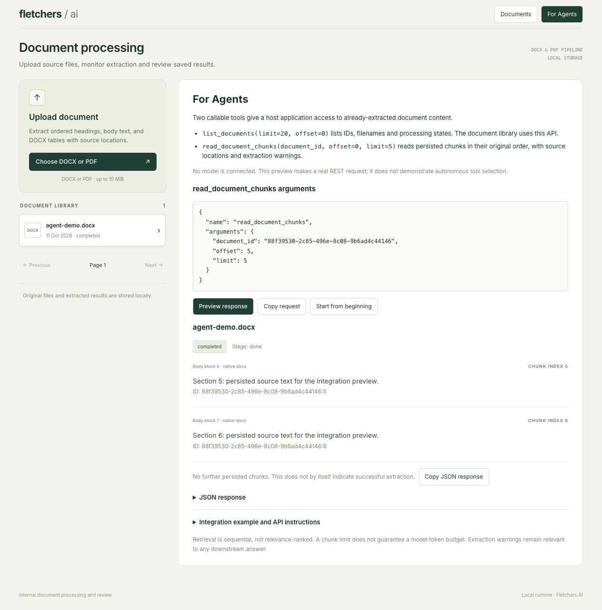

# Fletchers AI · Document pipeline

A local PDF/DOCX extraction app: upload documents, follow processing status, inspect ordered content and retrieve persisted results. No paid services are required.



- **Page-aware PDF extraction:** native inspection selects each page's route; Tesseract handles scanned pages, with explicit warnings for partial output.
- **DOCX structure:** headings, paragraphs and tables retain their body order.
- **For Agents:** preview persisted, source-aware chunks through REST. No model is connected.
- **Specialist fallback (mocked):** an optional provider boundary demonstrates escalation and response mapping, with clearly labelled fixture output.
- **Format adapters:** PDF and DOCX share a validation/extraction contract, providing an extension point for additional formats. Only PDF and DOCX are enabled.

## Run

Requires Docker with Compose for the backend and Node/npm for the frontend. Node 22.22.1 was used for verification.

From the repository root:

```sh
docker compose up --build
```

In a second terminal, from the repository root:

```sh
cd frontend
npm ci
npm run dev
```

Open the [app](http://127.0.0.1:5173). The frontend proxies requests to port 8000; [Swagger / API documentation](http://127.0.0.1:8000/docs) provides endpoints and request/response schemas.

Docker includes Python 3.12 and Tesseract with English language data. Uploads and SQLite results persist in the `backend-data` volume. `docker compose down` retains this data; adding `--volumes` deletes it.

### Native backend alternative

With [uv](https://docs.astral.sh/uv/) installed, instead of Docker:

```sh
cd backend
uv sync --locked
uv run uvicorn app.main:app --host 127.0.0.1 --port 8000
```

The project selects Python 3.12 and requires 3.12+. Real OCR needs Tesseract with English data: `brew install tesseract` on macOS, or `sudo apt install tesseract-ocr tesseract-ocr-eng` on Debian/Ubuntu. Check with `tesseract --list-langs`. Missing OCR produces an explicit warning; specialist fallback is disabled by default.

Native data defaults to `backend/data/` with these commands. Set `DATA_DIR` to change it; `MAX_UPLOAD_BYTES` defaults to 10 MiB. Run one backend process.

## Try the demos

The synthetic [demo files](demo/) are ready to upload.

| File | What to inspect |
|---|---|
| [agreement.docx](demo/agreement.docx) | Heading → paragraph → table → paragraph, with body positions. |
| [digital.pdf](demo/digital.pdf) | Native extraction and PDF page provenance. |
| [scan.pdf](demo/scan.pdf) | OCR routing and recognised invoice text, or an OCR-unavailable warning. |
| [mixed.pdf](demo/mixed.pdf) | Five pages: NATIVE, OCR, HYBRID, searchable-scan NATIVE and EMPTY_OR_UNKNOWN. |
| [ai-fallback.pdf](demo/ai-fallback.pdf) | Optional mock fallback: native page, vector-stroke page with a fixture table, then blank page. Enable it using the [fallback guide](docs/specialist-fallback.md). |

Switch between structured blocks and readable text, inspect route decisions and warnings, then reload to retrieve saved results. Small files finish quickly; progress reflects actual stages and page counts.

Select a document and open **For Agents** to preview chunks and copy requests/responses. The [agent guide](docs/agent-integration.md) includes a runnable Python pagination example. The [adapter guide](docs/document-adapters.md) explains how another format joins the pipeline.

## Verify

```sh
# From the repository root:
cd backend
uv sync --locked
uv run pytest tests -q
cd ../frontend
npm ci
npm test
npm run build
npm run lint
```

Tests use temporary storage and labelled mocks; no paid provider or Tesseract installation is required.

## Limits

- Local PDF extraction does not reconstruct headings, tables or complex layouts. HYBRID preserves native text and warns about unprocessed images; searchable-scan text is not verified against the image.
- DOCX covers top-level body content. OCR is English Tesseract without deskew or layout reconstruction.
- Specialist fallback makes no network/model calls and does not establish extraction accuracy. Its demo output is mocked.
- Background tasks are not durable; interrupted jobs fail on restart and require re-upload. Completed results persist.
- Chunk retrieval is sequential; batch size does not guarantee a model token budget. There is no authentication or production queue.
